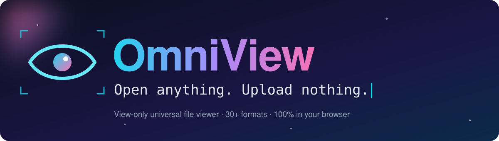
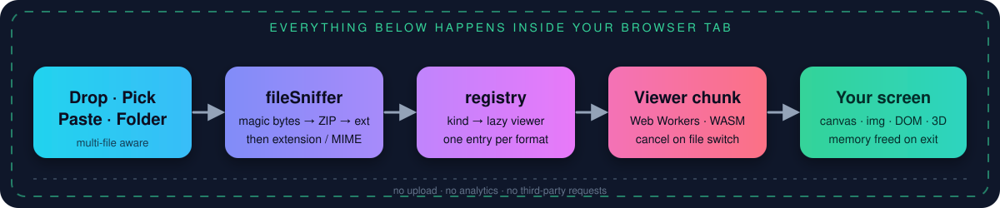

<div align="center">



<br/>

[](https://react.dev)
[](https://www.typescriptlang.org)
[](https://vitejs.dev)
[](https://tailwindcss.com)
[](https://playwright.dev)
[](https://vitest.dev)
[](#-install-as-an-app-pwa)
[](#-privacy--security)
[](LICENSE)

### 👁️ A view-only universal file viewer that runs entirely in your browser.
**Images · RAW · PSD · PDF · 3D models · Word · Excel · PowerPoint · and more.**<br/>
No uploads. No analytics. No third-party requests. No editing, ever.

<br/>

[**🚀 Quick start**](#-quick-start) &nbsp;•&nbsp; [**🎞️ Formats**](#-supported-formats) &nbsp;•&nbsp; [**🧠 How it works**](#-how-it-works) &nbsp;•&nbsp; [**☁️ Deploy**](#-deploy-to-github-pages) &nbsp;•&nbsp; [**🔒 Privacy**](#-privacy--security) &nbsp;•&nbsp; [**✅ Verification**](#-verification-status)

<br/>


</div>

> [!NOTE]
> **Status:** the code, tests, fixtures and deploy configs are complete. The pure detection / extraction logic and the optional converter service have been executed against real fixtures; the full `build → lint → typecheck → test → e2e` pipeline has **not** been run yet. Run it once (see [Quick start](#-quick-start)) and read [VERIFICATION.md](VERIFICATION.md), which lists exactly what was and was not run.


## ✨ Why OmniView

<table>
<tr>
<td width="33%" valign="top">

### 🔒 Private by design
Everything is decoded **in your browser tab**. A strict CSP (`self`, `blob:`, `data:`), no analytics and no runtime network calls to third parties.

</td>
<td width="33%" valign="top">

### 🧬 Detects what a file *is*
Magic bytes first, then ZIP contents, then extension and MIME. A PNG named `.jpg` or a DOCX named `.txt` still opens correctly.

</td>
<td width="33%" valign="top">

### ⚡ Lean by default
Every heavy library is behind `React.lazy` / `import()`. TIFF, HEIC and RAW decode in **Web Workers**; switching files cancels the work.

</td>
</tr>
<tr>
<td valign="top">

### 🧩 One-line extensibility
Add a format by registering **one entry** in `registry.ts`. No viewer knows about any other.

</td>
<td valign="top">

### 🛡️ One bad file never crashes it
A per-file error boundary, friendly messages, and a size warning (default 200 MB) with an **Open anyway** option.

</td>
<td valign="top">

### ♿ Accessible & responsive
ARIA labels, focus management, reduced-motion support, a keyboard-help overlay and a layout that holds down to **360 px**.

</td>
</tr>
</table>


## 🧠 How it works

<div align="center"></div>

1. **Open** a file by drag-and-drop, the file picker, a whole folder, several files at once, or paste an image from the clipboard.
2. **`fileSniffer`** identifies the real type from magic bytes, looks inside ZIP containers (DOCX / XLSX / PPTX / ODF), and only then trusts the extension.
3. **`registry`** maps the detected kind to a lazily imported viewer. Anything unregistered gets a clear "not supported" screen.
4. The **viewer** decodes (in a worker where practical), renders, and **frees everything** (Blob URLs, bitmaps, canvases, GPU resources, workers) when you move on.


## 🎞️ Supported formats

| | Format | Library / approach | Notes |
|:-:|---|---|---|
| 🖼️ | **JPEG · PNG · GIF · WebP · AVIF · BMP** | native `` from a Blob URL | zoom, pan, pinch, rotate, fit / fill / 100%, checkerboard, animated GIF |
| 🎨 | **SVG** | DOMPurify → `` from a Blob | never inlined, so scripts can't run; **view-source** toggle |
| 🗂️ | **TIFF / TIF** | `utif2` in a Web Worker | multi-page switcher |
| 📱 | **HEIC / HEIF** | `libheif-js` (WASM) in a Web Worker | multi-image switcher |
| 🖌️ | **PSD** | `ag-psd` | composite + read-only layer list with visibility toggles |
| 📷 | **RAW** `.raw .cr2 .cr3 .nef .nrw .arw .dng .orf .rw2 .raf .pef .srw` | largest **embedded JPEG preview**, in a Web Worker | never decodes sensor data; says so when there is no preview |
| ✏️ | **AI** | `pdfjs-dist` (PDF-compatible files) | explains clearly when there is no PDF stream |
| 📐 | **EPS** | embedded TIFF / `%%BeginPreview` preview, optional Ghostscript WASM | no PostScript interpreter ships by default |
| 📄 | **PDF** | `pdfjs-dist` with a local worker | pages, zoom, thumbnails, selectable text, search, **password prompt** |
| 🧊 | **OBJ (+MTL) · GLB · glTF (+bin)** | `three` loaders | orbit, auto-frame, lighting presets, wireframe, grid / axes, stats; multi-file drop resolves sidecars |
| 📝 | **DOCX** | `docx-preview` | |
| 📊 | **XLSX · XLS · ODS · CSV** | SheetJS (official CDN tarball) | virtualized read-only grid, sheet tabs |
| 📽️ | **PPTX** | `pptx-preview` | slide navigator |
| 📃 | **ODT · ODP · RTF · TXT · MD** | `fflate` + DOM parsing, own RTF reader | best-effort **text only** |
| 🕰️ | **DOC · PPT** (legacy) | not renderable client-side | clear message + [optional converter](#-optional-legacy-office-converter) |

<details>
<summary><b>⌨️ Keyboard shortcuts</b></summary>

| Key | Action |
|---|---|
| `←` / `→` | previous / next file |
| `+` `−` `0` | zoom in / out / fit |
| `R` | rotate 90° (view only) |
| `I` | info & metadata panel (EXIF / IPTC / XMP) |
| `F` | fullscreen |
| `S` | slideshow |
| `PageUp` / `PageDown` | previous / next slide |
| `?` or `H` | help overlay |
| `Esc` | close dialogs |

</details>


## 🚀 Quick start

```bash
git clone https://github.com/MUdevelops/omniview.git
cd omniview

npm install                       # also creates package-lock.json
npx playwright install chromium   # only needed for the e2e tests

npm run typecheck && npm run lint && npm test
npm run dev                       # http://localhost:5173
```

> [!TIP]
> Versions are pinned exactly, but a few were pinned from memory. If one doesn't resolve, run `npm view <package> versions` and re-pin it. The least certain ones are listed in [VERIFICATION.md](VERIFICATION.md).

### Scripts

| Script | What it does |
|---|---|
| `npm run dev` · `build` · `preview` | dev server · `tsc --noEmit && vite build` → static `dist/` · serve `dist/` with the real security headers |
| `npm run typecheck` · `lint` | strict TypeScript · ESLint 9 (typescript-eslint, react-hooks) |
| `npm test` | Vitest + Testing Library: sniffer, RAW / EPS / RTF parsers, formatters, components, deploy-config drift |
| `npm run test:e2e` | Playwright against the production build: one or more tests per format |
| `npm run fixtures` | regenerate `tests/fixtures/` programmatically |


## ☁️ Deploy to GitHub Pages

The repo ships a workflow (`.github/workflows/deploy.yml`) that builds on every push to `main` and publishes `dist/` to **GitHub Pages** at `https://mudevelops.github.io/omniview/`.

```bash
# 1. install (creates package-lock.json, which CI's `npm ci` needs) and sanity-check
npm install
npm run typecheck && npm test

# 2. commit
git init -b main
git add .
git commit -m "feat: OmniView universal file viewer"

# 3. create the GitHub repo and push (GitHub CLI: https://cli.github.com)
gh auth login
gh repo create MUdevelops/omniview --public --source=. --remote=origin --push

# 4. turn on Pages with "GitHub Actions" as the source
gh api -X POST repos/MUdevelops/omniview/pages -f build_type=workflow

# 5. watch the deployment
gh run watch
```

<details>
<summary><b>No GitHub CLI? Use the website instead</b></summary>

```bash
# after steps 1-2 above:
git remote add origin https://github.com/MUdevelops/omniview.git
git push -u origin main
```
Then on GitHub: **Settings → Pages → Build and deployment → Source: GitHub Actions**, and open the **Actions** tab to watch the run.

</details>

> [!IMPORTANT]
> GitHub Pages **cannot send HTTP headers**, so the workflow builds with `VITE_META_CSP=1`, which mirrors the Content-Security-Policy as a `<meta>` tag (`frame-ancestors` can't be expressed that way). It is the same policy, but a meta tag is weaker than a real header. This mode has not been tested in a browser yet; if anything fails to load on Pages, open DevTools, look for a CSP message, and remove `VITE_META_CSP` from the workflow to compare. For true headers, use one of the hosts below.

`VITE_BASE` is set to `/<repo-name>/` automatically. For a user site (`<user>.github.io`) or a custom domain, change it to `/` in `deploy.yml`.

### Other targets

| Host | How |
|---|---|
| 🐳 **Docker / nginx** | `docker build -t omniview . && docker run -p 8080:80 omniview` |
| ▲ **Vercel** | import the repo; `vercel.json` sets the build and headers |
| 🟩 **Netlify** | `netlify.toml` + `public/_headers` |
| 🟧 **Cloudflare Pages** | build `npm run build`, output `dist`; `public/_headers` is honoured |
| 📦 **Any static host** | upload `dist/` and replicate `public/_headers`; serve `.wasm` as `application/wasm` |

Vercel, Netlify, Cloudflare Pages and nginx all send the real headers (CSP, `X-Content-Type-Options`, `Referrer-Policy`, `Permissions-Policy`), generated from a single source, `config/headers.ts`. A unit test fails if the copies drift.


## 📲 Install as an app (PWA)

`vite-plugin-pwa` provides an offline app shell and an installable manifest with icons and **`file_handlers`**, so on Chromium the installed app can appear in your OS **Open with** list. The optional Ghostscript WASM is deliberately not precached.

## 🔒 Privacy & security

| | |
|---|---|
| **Local only** | Files are read with the File API and decoded in-tab. Nothing is uploaded; the footer says so. |
| **CSP** | `default-src 'self'`; images `self blob: data:`; `worker-src 'self' blob:`; `'wasm-unsafe-eval'` only for WebAssembly. No `unsafe-eval`, no inline scripts. |
| **SVG** | sanitised with DOMPurify and rendered via `` from a Blob, never inline. An e2e test opens a hostile SVG and asserts nothing runs. |
| **Documents** | DOCX links are limited to `http(s)` / `mailto` and open with `noopener noreferrer`. |
| **Memory** | Blob URLs revoked, bitmaps closed, canvases zeroed, workers terminated, three.js GPU resources disposed, PDF documents destroyed. |
| **Only exception** | The *optional* legacy `.doc` / `.ppt` converter. It is off by default and uploads a file only after an explicit click. |

## 🏗️ Architecture

```text
omniview/
├─ src/
│  ├─ core/          fileSniffer · registry · store · pure parsers (rawPreview, epsPreview, rtf, psdLayers, format)
│  ├─ viewers/       one lazy viewer per format family (Image, Tiff, Heic, Psd, Raw, Eps, Pdf, Model, Docx, Sheet, Pptx, Text, Legacy)
│  ├─ workers/       tiff · heic · raw decoders + a shared message protocol
│  └─ components/    Dropzone · Sidebar · Toolbar · MetadataPanel · HelpOverlay · PanZoom · ErrorBoundary
├─ config/headers.ts single source of truth for security headers
├─ server/           optional LibreOffice converter (Docker, disabled by default)
├─ tests/            unit/ · e2e/ · fixtures/ (41 generated files, edge cases included)
└─ .github/workflows CI (typecheck, lint, unit, e2e) and Pages deploy
```

### ➕ Add a format in three steps

```ts
// 1. src/core/fileSniffer.ts : add the FileKind and its detection line
// 2. src/viewers/MyViewer.tsx : write the viewer (receives { file, kind, siblings })
// 3. src/core/registry.ts     : register it with ONE entry
{ kinds: ['myfmt'], viewer: lazy(() => import('../viewers/MyViewer')) },
```

## 🧰 Optional legacy Office converter

Browsers can't render binary `.doc` / `.ppt` reliably. [`/server`](server/README.md) contains a dependency-free Node service that wraps LibreOffice in Docker. It is **disabled unless `ENABLE_CONVERSION=true`**, and the viewer only shows the "Convert on server" button when the app is built with `VITE_CONVERSION_URL`.

```bash
cd server && docker compose up --build
```

## ✅ Verification status

Honest summary (details and the per-format table are in [**VERIFICATION.md**](VERIFICATION.md)):

| Check | Status |
|---|---|
| Detection + extraction logic vs. every fixture (plain Node) | ✅ 47 / 47 |
| Fixtures validated with independent tools | ✅ |
| Converter service with real LibreOffice (`.doc` / `.ppt` → PDF) | ✅ |
| `npm install` · `build` · `lint` · `typecheck` · `test` · `test:e2e` | ⏳ **not run yet**, so run them once |
| HEIC | ⏳ no fixture (no HEVC encoder was available) |

## ⚠️ Known limitations

- **EPS / AI** without an embedded preview or PDF stream can't be drawn (no PostScript interpreter by default).
- **RAW** is preview-only, and was only tested on a synthetic file.
- **PSD** parses on the main thread; layer toggles ignore blend modes, masks and effects.
- **glTF** with Draco / KTX2 / Meshopt compression isn't supported.
- **Legacy `.doc` / `.ppt`** can't be rendered client-side; ODT / ODP / RTF are text only.
- PDF search jumps between matching pages but doesn't highlight hits.

## 🤝 Contributing

1. Fork, then `git checkout -b feat/my-format`
2. Add the format (see [three steps](#-add-a-format-in-three-steps)) **and a fixture + Playwright test for it**
3. `npm run typecheck && npm run lint && npm test && npm run test:e2e`
4. Open a pull request

## 📄 License

[MIT](LICENSE) © 2026 Muhammad Umar Jamal

<div align="center">


**Build AI. Engineer Systems. Ship Applications.**

Made by [**@MUdevelops**](https://github.com/MUdevelops) &nbsp;•&nbsp; ⭐ Star the repo if OmniView is useful to you

</div>
